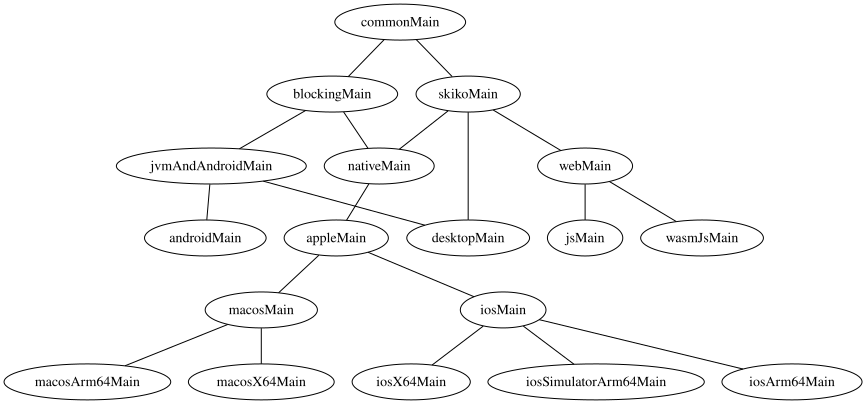

# KMP-hierarchy
### Gradle Plugin to investigate KMP project's hierarchy

--------------
This open-source Gradle plugin aims to help developers investigate 
the HMPP structure of Kotlin Multiplatform (KMP) source sets with ease.
By graphically visualizing the relationships between source sets and clearly indicating their hierarchy, 
the plugin simplifies understanding and maintaining complex KMP projects.

--------------
⚠️ This project hasn’t been updated in a while because it’s stable and does its job. ⚠️  
There’s no need to turn a simple utility into another framework for the sake of change.  
Keeping it small and focused — [KISS](https://en.wikipedia.org/wiki/KISS_principle)! 💋

--------------
## Features
- Graphical visualization of dependencies between source sets
- Seamless Integration with Gradle builds
- Full compatibility with any KMP project
- Various output formats (SVG, PNG, JSON, DOT etc)

--------------
## Installation
To use KMP-hierarchy plugin, include the following in your build.gradle(.kts) file:
```kotlin
plugins {
    id("io.github.terrakok.kmp-hierarchy").version("1.1")
}
```

--------------
## Usage
After successful installation, the plugin will be ready to use.
```text
./gradlew :printHierarchy
```
Example of SVG output for [compose-multiplatform/components/resources/library](https://github.com/JetBrains/compose-multiplatform/blob/master/components/resources/library/build.gradle.kts) module:


--------------
## Configuration

```kotlin
plugins {
    id("org.jetbrains.kotlin.multiplatform").version("1.9.23")
    id("io.github.terrakok.kmp-hierarchy").version("1.1")
}

kotlin {
    //...
    printHierarchy {
        //Sets the formats to be used for generating output files.
        formats(Format.SVG)

        //Boolean variable indicating whether to include test hierarchy in the generated output.
        withTestHierarchy = false

        //The output directory where the generated files will be saved.
        outputDir.set(layout.buildDirectory.dir("kmp-hierarchy"))
    }
}
```
